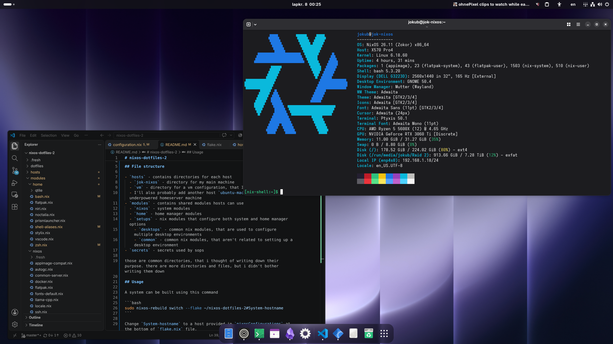

# nixos-dotfiles-2

My NixOS configuration setup



## File structure

- `hosts` - contains directories for each host
  - `jok-nixos` - directory for my main machine
  - `vm` - directory for a vm configuration, that I abandoned
  - I'll also probably add another host `ubuntu-mac-mini` for current underpowered homeserver machine
- `modules` - contains shared modules hosts can use
  - `nixos` - system modules
  - `home` - home manager modules
  - `setups` - nix modules that configure both system and home manager options
    - `desktops` - common nix modules, that are used to configure multiple desktop environments
    - `common` - common nix modules, that aren't related to setting up a desktop environment
- `secrets` - secrets used by sops

those are common directories, that i thought of writing down their purpose. there are more directories and files, but i didn't bother writing them down

## Usage

A system can be built using this command

```bash
sudo nixos-rebuild switch --flake ~/nixos-dotfiles-2#System-hostname
```

Change `System-hostname` to a host provided in `nixosConfigurations` at the bottom of `flake.nix` file.
My main machine is `jok-nixos`

Also you can use a shell alias to build a system quicker (only configured for `jok-nixos` for now):
```bash
nrs
```

---

If you found this git repository for some reason, then I'd suggest to take a look at NixOS tutorials at [Tony's YouTube channel](https://www.youtube.com/@tony-btw) and [Vimjoyer's YouTube channel](https://www.youtube.com/@vimjoyer). This repository doesn't contain anything particularly new
